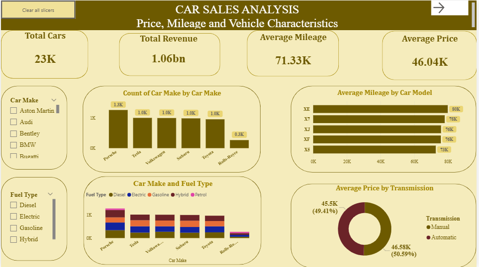
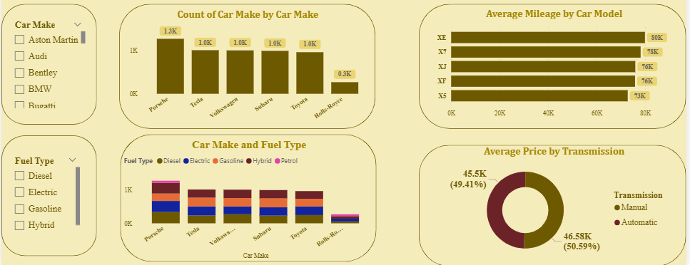
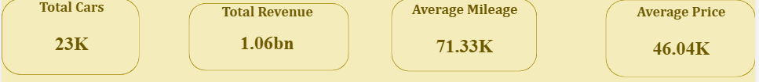

🚗 Strategic Insights into Car Sales Performance & Pricing Dynamics

An end-to-end data analytics and business intelligence solution designed to track, evaluate, and optimize vehicle pricing structures, inventory turnover metrics, and margin performance across regional dealerships.

📘 The Business Story (Project Overview)

The Challenge

A scaling automotive enterprise experienced a sharp surge in transaction volume but lacked a centralized, real-time mechanism to monitor dealership performance and inventory depreciation. Key leadership metrics—such as margin compression, vehicle age on the lot, regional demand variations, and post-purchase customer satisfaction—were trapped across separate, disconnected regional tables. The executive team needed to instantly identify which vehicle categories generated the highest profitability, how mileage thresholds affected market velocity, and where pricing strategies needed immediate correction to protect bottom-line margins.

The Solution

I built an interactive, business-critical Automotive Market Intelligence Dashboard in Power BI to serve as a single source of truth for cross-functional leadership teams (Procurement, Sales, and Finance). By integrating multi-dimensional market variables into a clean star-schema data model, the dashboard translates complex, fragmented dealership transactions into highly scannable, interactive visual assets.
The interface empowers stakeholders to instantly filter data across key dimensions (Vehicle Make, Fuel Type, Transmission, and Regional Tiers) to quickly diagnose underperforming inventory, optimize procurement strategies, and maximize total portfolio revenue.

🛠️ Tech Stack & Advanced Engineering

• Business Intelligence / Data Viz: Power BI Desktop
• Data Modeling: Power BI Data Model View (Star Schema Architecture)
• Data Extraction & Transformation (ETL): Power Query (Advanced schema enforcement, structural data cleaning, M-code optimizations)
• Key Fields Unified & Analyzed: vehicle_id, purchase_price, sale_price, mileage_lifecycle, fuel_type, transmission_type, days_on_lot, regional_market

🎯 Key Metrics & Interactive Visualizations

The final analytical interface uncovers strategic performance indicators across thousands of unique vehicle transactions:

1. High-Level Performance KPIs (Executive Overview)

• Total Portfolio Volume: 23K Unique Vehicles actively tracked through the sales lifecycle.
• Financial Footprint: $1.06 Billion in Gross Revenue analyzed, establishing a comprehensive market baseline.
• Average Capital Optimization: Optimized baseline valuation modeling across diverse brand tiers to target margin leakage.

2. Analytical Deep Dives & Core Findings

• Price Degradation vs. Mileage: Side-by-side trend analysis isolates the exact inflection points where high mileage drastically accelerates asset depreciation, directly informing trade-in appraisal logic.
• Transmission & Fuel Pipeline: Clean visual matrices map shifting consumer demand toward fuel-efficient and hybrid models, signaling a clear strategic pivot for the inventory procurement team.
• Days on Lot by Segment: Horizontal charts segment inventory velocity by lifestyle and vehicle classes, identifying stagnant luxury models and high-turnover economy segments to minimize holding costs.

🚧 Complex Challenges Overcome

• Data Disparities & Cleansing: Handled inconsistent manufacturer naming conventions, missing transaction data, and overlapping regional codes using robust Power Query normalization rules to ensure perfect reporting boundaries.
• Performance Optimization: Prevented visual lag across heavy multi-variable calculations by replacing resource-heavy calculated columns with highly optimized, lightweight DAX measures to guarantee sub-second dashboard rendering times for executives.

🤝 Let's Collaborate / Hire Me

I specialize in transforming chaotic operational data into automated, intuitive assets that protect profit margins and drive business strategy. Looking for a data analyst who can translate raw metrics into immediate business ROI? Let's connect.

## 📬 Connect with Me

| Contact Method | Link |
| :--- | :--- |
| 📧 **Email** | <ayomidehusseinat@gmail.com> |
| 💼 **LinkedIn** | [linkedin.com](https://linkedin.com) |
| 📁 **Portfolio** | [yourportfolio.com](https://yourportfolio.com) |

• 📧 Email: [mailto:ayomidehusseinat@gmail.com]
• 💼 LinkedIn: [linkedin.com]
• 📁 Portfolio: [yourportfolio.com]
